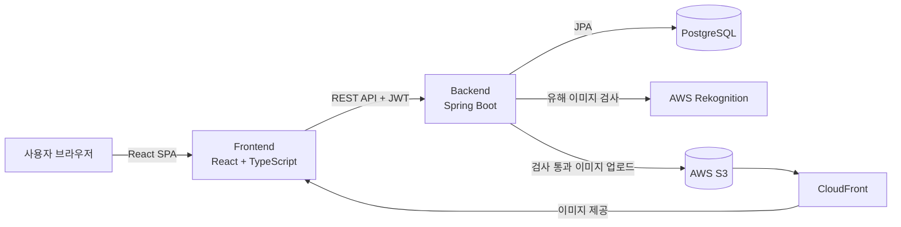

# UbiCollab

> 문서 작성부터 폴더 관리, 공유·권한 관리, 댓글과 공지까지 지원하는 **웹 기반 협업 문서 드라이브**

<!-- TODO: 대표 스크린샷 또는 시연 GIF -->
<!--  -->

- **개발 기간**: 2026.07 ~ 진행 중
- **개발 인원**: 1인 (기획 · DB 설계 · 백엔드 · 프론트엔드 · AWS 연동)
- **시연 영상**: <!-- TODO: 링크 -->

<br>

## 기술 스택

| 구분 | 기술 |
| --- | --- |
| **Backend** | Java 21, Spring Boot 3.5, Spring Security, Spring Data JPA, JWT (jjwt), Bean Validation |
| **Frontend** | React 19, TypeScript, Vite, TanStack Query, MUI, Tiptap Editor, Axios, DOMPurify |
| **Database** | PostgreSQL |
| **Infra / Cloud** | AWS S3, CloudFront, Rekognition |
| **Tools** | Git / GitHub (Issue · PR 기반 개발), Eclipse, VS Code, WSL2 |

<br>

## 아키텍처



<br>

## 주요 기능

### 📁 드라이브
- 파일·폴더 생성, 이름 변경, 이동, 폴더 탐색(Breadcrumb 경로 네비게이션)
- **내 드라이브 / 공유 문서함 / 최근 문서 / 즐겨찾기 / 휴지통** 탭
- 휴지통 이동 · 복원 · 영구 삭제

### 📝 문서 편집
- Tiptap 기반 리치 텍스트 에디터
- **자동 저장** (변경된 필드만 갱신)
- 에디터 안에서 내 드라이브 · 공유 · 즐겨찾기 문서 불러오기

### 🔐 공유 및 권한
- 사용자 검색 후 문서·폴더 공유
- **4단계 권한**: `VIEWER` → `COMMENTOR` → `EDITOR` → `MANAGER`
- 상위 폴더 권한이 하위 항목으로 **상속**
- 권한 수준에 따라 UI 메뉴 제한 + **모든 백엔드 API에서 권한 재검증**

### 💬 협업
- 본문 텍스트를 선택해 댓글 작성(Bubble Menu), 답글 · 수정 · 삭제
- 문서별 공지사항 작성 · 수정 · 삭제 (사이드 패널)

### 👤 회원
- 회원가입 · 로그인(JWT), 닉네임 · 비밀번호 변경, 회원 탈퇴
- 프로필 이미지 업로드 (S3 + CloudFront, 유해 이미지 자동 차단)

<br>

## 기술적 고민과 해결

### 1. 계층형 권한 시스템
**문제** — 폴더를 공유하면 그 안의 하위 파일에도 같은 권한이 적용되어야 하고, 화면에서 메뉴를 숨기는 것만으로는 API를 직접 호출해 우회할 수 있음

**해결**
- 항목에 직접 부여된 권한이 없으면 부모 폴더를 따라 올라가며 권한을 찾는 **상속 구조** 설계
- 기능마다 필요한 권한을 정해 검사 (예: 댓글은 `COMMENTOR` 이상, 공지 작성은 `MANAGER`)
- 프론트엔드 메뉴 제한과 별개로 **모든 API에서 서버 측 권한 검증** 수행

### 2. 내부 식별자 노출 방지
**문제** — URL과 응답에 DB 기본키(Auto Increment ID)가 드러나면 다른 리소스의 ID를 추측할 수 있음

**해결** — 엔티티마다 UUID 기반 `publicId`를 따로 두어 URL과 응답에서는 `publicId`만 사용, 기본키는 외부로 내보내지 않음

### 3. 비밀번호 해싱 강화 (Pepper)
**문제** — DB가 유출되면 BCrypt 해시만으로는 오프라인 대입 공격에 노출됨. 또한 BCrypt는 **입력이 72바이트를 넘으면 뒷부분을 무시**함

**해결** — 서버만 아는 pepper로 `HMAC-SHA256`을 먼저 적용한 뒤 BCrypt로 해싱
```
저장값 = BCrypt( Base64( HMAC-SHA256(password, pepper) ) )
```
단순 문자열 이어붙이기 대신 HMAC을 써서 입력 길이를 고정 길이로 만들어 72바이트 제한 문제도 함께 해결

### 4. 프로필 이미지 업로드 흐름 개선
단계적으로 개선하며 보안과 성능을 높임

| 단계 | 방식 | 문제점 / 개선 |
| --- | --- | --- |
| 1 | S3 URI 직접 저장·노출 | 버킷 경로가 그대로 노출됨 |
| 2 | **Presigned URL** 로 조회 | 버킷을 비공개로 유지, 일정 시간만 유효한 URL 발급 |
| 3 | **CloudFront** 로 이미지 제공 | 요청마다 URL을 새로 발급할 필요 없음, 캐싱으로 응답 속도 개선 |

- 업로드는 서버를 거치도록 바꿔, S3에 저장하기 전에 **AWS Rekognition**(`DetectModerationLabels`)으로 유해 이미지를 검사해 차단
- 회원 탈퇴 시 DB 데이터와 S3 이미지를 함께 삭제

### 5. 구조 개선 (리팩토링)
- 프론트엔드 **JavaScript → TypeScript** 전환
- 단일 `Document` 엔티티를 파일·폴더를 아우르는 `DriveItem` 구조로 재설계
- `@RestControllerAdvice` **전역 예외 처리**와 API 응답 상태 코드 통일
- DTO를 Java `record`로 바꾸고 입력 검증을 DTO 단계에 적용
- API 호출을 `api/` 계층으로 분리하고 **TanStack Query**(`useQuery`, `useMutation`)로 서버 상태 관리, 로그아웃 시 캐시 초기화
- UI 컴포넌트를 Tailwind에서 MUI로 통일, `window.confirm`을 MUI Dialog로 교체

<br>

## ERD

<!-- TODO: ERD 이미지 -->
주요 엔티티: `User`, `DriveItem`(파일/폴더, 자기 참조 parent), `Permission`, `Favorite`, `Comment`, `Announcement`

<br>

## API 개요

| 도메인 | Base Path | 주요 기능 |
| --- | --- | --- |
| 인증 | `/api/login` | 로그인 (JWT 발급) |
| 회원 | `/api/user` | 회원가입, 아이디 중복 확인, 사용자 검색, 프로필 업로드, 닉네임·비밀번호 변경, 탈퇴 |
| 드라이브 | `/api/driveitem` | 생성, 조회, 경로 조회, 이름 변경, 이동, 저장, 휴지통·복원·영구 삭제 |
| 권한 | `/api/permission` | 공유, 권한 변경·삭제, 공유받은 항목 조회 |
| 즐겨찾기 | `/api/favorite` | 추가, 조회, 삭제 |
| 댓글 | `/api/comment` | 작성, 조회, 수정, 삭제 |
| 공지 | `/api/announcement` | 작성, 조회, 수정, 삭제 |

<br>

## 프로젝트 구조

```
ubicollab
├── backend                         # Spring Boot
│   └── src/main/java/com/ubicollab
│       ├── user/                   # 회원, 로그인, JWT
│       ├── driveitem/              # 파일·폴더
│       ├── permission/             # 공유·권한
│       ├── favorite/               # 즐겨찾기
│       ├── comment/                # 댓글
│       ├── announcement/           # 공지
│       ├── common/                 # 전역 예외 처리
│       └── SecurityConfig.java ... # 보안 설정, 인증 필터, AWS 설정
└── frontend                        # React + TypeScript
    └── src
        ├── api/                    # API 호출 계층 (axios)
        ├── components/             # UI 컴포넌트 (modal, menu, editor ...)
        ├── hooks/
        └── pages/
```

<br>

## 실행 방법

### 요구 사항
- Java 21, Node.js 20+, PostgreSQL
- AWS 계정 (S3 버킷, CloudFront 배포, Rekognition 사용 권한)

### 1. 환경 변수 설정
`backend/.env` 파일을 만들고 아래 값을 채웁니다. (`.env`는 Git에 포함되지 않습니다.)

```env
DB_URL=jdbc:postgresql://localhost:5432/ubicollab
DB_USERNAME=
DB_PASSWORD=

JWT_SECRET=          # 32바이트 이상 임의 문자열
PASSWORD_PEPPER=     # 임의 문자열

AWS_ACCESS_KEY_ID=
AWS_SECRET_ACCESS_KEY=
AWS_S3_BUCKET=
CLOUDFRONT_DOMAIN=
```

### 2. Backend 실행 (`http://localhost:8080`)
```bash
cd backend
./gradlew bootRun
```

### 3. Frontend 실행 (`http://localhost:5173`)
```bash
cd frontend
npm install
npm run dev
```

<br>

## 한계 및 개선 계획

- [ ] **실시간 동시 편집**: 현재는 자동 저장 방식이며, WebSocket(STOMP) 또는 Yjs 기반 동시 편집 도입 검토
- [ ] **토큰 저장 방식**: JWT를 Local Storage에 저장하고 있어 XSS에 취약할 수 있음 → HttpOnly Cookie + Refresh Token 구조로 전환 예정
- [ ] **테스트 코드**: 권한 검증 로직을 중심으로 단위·통합 테스트 작성 예정
- [ ] **설정 분리**: CORS 허용 도메인, `ddl-auto` 등을 프로필(dev/prod)별로 분리
- [ ] **배포**: Docker 컨테이너화 및 AWS 배포
